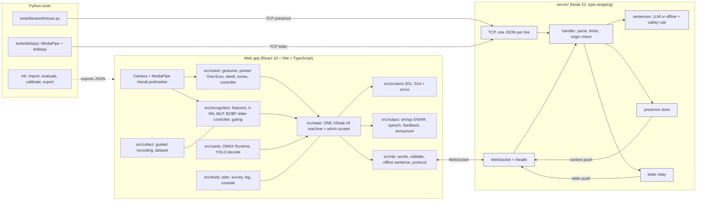

# SignScribe: project status (single reference)

> **ملخص بالعربي (مختصر)**
>
> **SignScribe** مشروع لمادة HCI (MSA, Fall 2026): كاميرا تحوّل إشارات اليد إلى جُمل مكتوبة، ونقارنها بلوحة المفاتيح والماوس في دراسة على مستخدمين.
>
> **اللي اتبنى (وبيشتغل في الاختبارات الآلية):** 14 شاشة بتتحكم فيها state machine واحدة، تتبّع اليد بـ MediaPipe، إيماءات وتأشير بالـ dwell بدون ماوس أو كيبورد، سيرفر الجُمل (WebSocket + TCP) مع قاعدة أمان، وضع الدراسة والاستبيانات، وضع تسجيل البيانات، أدوات Python للتقييم والتدريب، عربي (ArSL) بنصوص وصوت، سكانر Bluetooth (وهمي في الاختبار)، و dollarpy، و`npm run demo`.
>
> **اللي اتجرّب:** `npm run verify` عدّى 13 من 13 خطوة على Windows (على main + #25 + #26) وعلى Linux، بأيدي **اصطناعية** وأجهزة **وهمية** فقط. ده بيثبت المنطق، مش جودة التعرف على أيدي حقيقية.
>
> **اللي اتقاس (على جهاز يوسف، من صور ArSL21L، مش من webcam):** دقة leave-one-person-out المجمّعة: k-NN 91.1% و MLP 94.9% (مع augmentation). التفاصيل والحدود في قسم Models.
>
> **اللي لسه ما اتقاسش (NOT MEASURED):** دقة webcam حقيقية، fps وزمن الاستدلال على جهاز حقيقي، Bluetooth حقيقي، الصوت العربي على جهاز، أثر الـ letter gating على مستخدمين، عتبات الـ MLP داخل التطبيق.
>
> **اللي مش متدرّب:** موديل الحروف الإنجليزية (ASL)، كلاسات الـ controls (مفيش تسجيلات)، كلاس `none`، وأي موديل متدرّب على تسجيلات webcam بتاعتنا. موديلات ArSL (k-NN و MLP) اتدرّبت على جهاز يوسف من ArSL21L بـ `ml/export_arsl.py`، وملفات الـ JSON **مش في git**.
>
> **اللي لسه مفتوح:** `docs/KNOWN_ISSUES.md` (منسوخ بالكامل تحت)، وملخص "What is not built" و"Not measured" تحت.

---

This file is the long reference for the whole project. It is built from the repository (code, tests, docs, `npm run verify` results) and from `docs/MODEL_RESULTS.md` (written by `ml/evaluate.py`; the single source for accuracy numbers) plus the two numbers Youssef supplied for an invalid run (marked as invalid). Where nothing was measured it says **NOT MEASURED**. It never states a camera result: **nothing in this repository has been verified on a real camera with a real hand.**

Status words used everywhere: **verified here** (an automatic test or run proves the logic, with synthetic hands, fake devices or generated data), **needs a real camera / device** (only checkable on real hardware), **not met / not built**.

Contents: 1 Purpose and course requirements, 2 Architecture, 3 Screens and flow, 4 Features (file and test), 5 Sentence server and validators, 6 Models, 7 Datasets and licences, 8 Study design, 9 Phase II sheet, 10 How to run (Windows and Linux), 11 Known issues, 12 What is not built, 13 Privacy rules, 14 How to extend, 15 Team workflow, 16 Verification state, 17 Roadmap.

## 1. Purpose and course requirements

**Purpose.** A camera-based interface that turns hand signs into written sentences (`CLAUDE.md`, `README.md`). Target users of the product: people who communicate with signs and need to write short messages in everyday places (clinic, shop, work, home). The participants of the course study are MSA students and acquaintances, not the target users (`docs/STUDY.md`); results say something about the techniques for first-time users, not about signers.

**Course requirements** (from the lab slides, as recorded in `CLAUDE.md`):
- Compare **two interaction techniques**, evaluated on user satisfaction, engagement, usability and surveys. Technique 1 = camera hand signs; technique 2 = keyboard and mouse (decided). Within-subject, order counterbalanced.
- Lab 2 usability rules used for grading: navigation, familiarity, consistency, error prevention, feedback, visual clarity, flexibility and efficiency.
- Lab 3 survey rules: closed, specific, unbiased questions; balanced answer choices of equal ranges; a neutral middle; define the problem and users first.
- Labs use Python (MediaPipe, dollarpy, sockets). Decided: training in Python (k-NN for static letters, `$1`/`$P` only for moving signs); the browser app consumes exported model JSON.
- Course deadlines (course Phase 1 week 4, Phase 2 week 6, Phase 3 week 13, Phase 4 week 14). What course Phase 2 requires is still being confirmed with the TA; this repository does not assume it equals the phases in `PLAN.md`.

**Hard rules of the project** (`CLAUDE.md`): never state an accuracy, fps or latency number unless measured on a real camera with real hands; gesture thresholds are heuristics and a reported misfire gets a reproducing test first; the sign-recognition model is not vibe-coded (tooling only, the team trains and evaluates); `npm run check` green on every commit; branches and pull requests, merges to `main` only when Youssef asks; every primary action has a gesture equivalent, immediate feedback and error recovery.

## 2. Architecture

**Folder map**

| Folder | What lives there |
| --- | --- |
| `config/alphabets/*.json` | label sets (ASL ready; ArSL = 32 ArSL21L classes + 4 controls, `reviewed: false`) read by the web app and `ml/` |
| `src/state/` | the XState machine = the only owner of "which screen" (14 screens, overlays 08 and 13), settings, profiles |
| `src/vision/` | camera, MediaPipe, landmarks, gestures, pointer, dwell, zones, controller, checks |
| `src/screens/`, `src/ui/` | screens S01..S14 (no click/key handlers, a test enforces it) and the shared components |
| `src/recognition/` | feature vector, k-NN, MLP forward pass, `$1`/`$P`, letter controller with gating, per-model tuning, priority, letter log |
| `src/nlp/` | word lists, validator, offline sentence, protocol, WebSocket clients |
| `src/output/` | EN/AR string table, speech, sound/vibration feedback, aria-live announcer |
| `src/study/`, `src/collect/`, `src/cards/`, `src/dev/`, `src/perf/` | study mode, collection mode, picture cards, developer panels (`?dev=1`), perf recorder |
| `server/` | sentence server (WebSocket + TCP) |
| `ml/` | Python training and evaluation tooling |
| `tools/` | models download, e2e and layout checks, compare, bluetooth scanner, dollarpy demo, demo-all, shared launchers |
| `docs/` | documents (this file, DONE, KNOWN_ISSUES, STUDY, CONTROLS, CREDITS, ...) |

**Models and data flow.** MediaPipe gives 21 hand points per frame. `src/recognition/features.ts` and `ml/signscribe_ml/features.py` compute the same "hand60-v1" feature vector (a parity test keeps them equal). The browser reads `public/models/letters-*-mlp.json` (preferred) and `letters-*-knn.json` (fallback), and `motion-*-dollar.json` for moving letters/controls.

## 3. Screens and flow (14)

`src/state/machine.ts` is the only owner of the screen; `tests/machine.test.ts` covers every event and transition and a breadth-first search proves there is no dead end.

| # | Screen | File | Purpose |
| --- | --- | --- | --- |
| 01 | Welcome | `S01Welcome.tsx` | wake with an open hand held for 2 s |
| 02 | Camera check | `S02CameraCheck.tsx` | light, distance and hand checks before starting |
| 03 | Preferences | `S03Preferences.tsx` | which hand signs, which alphabet (English / Arabic; "More" = coming soon) |
| 04 | Context | `S04Context.tsx` | where are you today (Clinic, Shop, Work, Home); a place can be set by Bluetooth with a visible override |
| 05 | Method | `S05Method.tsx` | spell with signs or show a picture card |
| 06 | Spell, ready | `S06SpellReady.tsx` | waiting for a letter; a letter offered by the dollarpy client appears here |
| 07 | Spell, recognising | `S07SpellRecognizing.tsx` | the hold ring and the top guess |
| 08 | Hand lost | `S08HandLost.tsx` | overlay: the message is kept, bring the hand back |
| 09 | Word suggestion | `S09WordSuggestion.tsx` | "Did you mean this word?" |
| 10 | Picture card | `S10PictureCard.tsx` | choose a word by card |
| 11 | Review sentence | `S11ReviewSentence.tsx` | look at the sentence; thumbs up to continue |
| 12 | Share | `S12Share.tsx` | reachable only after 11 + thumbs up (safety rule); read aloud |
| 13 | Gesture guide | `S13GestureGuide.tsx` | overlay on both hands up: help, About and credits |
| 14 | Comfort | `S14Comfort.tsx` | text size, contrast, hold time, voice, sound/vibration feedback |

Gestures (rule-based, `src/vision/gestures.ts`): open palm, fist, thumbs up, thumbs down, point, none. Commands act in a command zone (`src/vision/zones.ts`); point and hold (dwell, default hold time shown in the vision debug panel, adaptive in "auto") selects targets. Wake needs an open hand for 2 s, help both hands for 1 s. Tests: `tests/gestures.test.ts`, `tests/controller.test.ts`, `tests/dwell.test.ts`, `tests/pointer.test.ts`, `npm run e2e` (48 checks, whole flow 01 to 12 to 01 with synthetic hands and proof that mouse and keys do nothing).

The thresholds are heuristics and **have not been tuned on a real camera** (`docs/PHASE2_CHECKLIST.md` is the procedure; it is still to be filled in).

## 4. Features built: where they live and how they are tested

All of these are **verified here** (synthetic or generated inputs) unless the last column says otherwise. "Real hardware" means not yet tried.

| Feature | Where | Test / check | Real hardware |
| --- | --- | --- | --- |
| State machine, overlays, safety rule (12 only after 11 + thumbs up) | `src/state/machine.ts` | `tests/machine.test.ts` | n/a |
| Camera, MediaPipe, status banner, camera-error messages (denied, no camera, in use, not supported, insecure, unknown; EN + AR) | `src/vision/camera.ts`, `VisionProvider.tsx`, `StatusBanner.tsx`, `src/output/strings.ts` (`cameraProblem`) | `tests/camera-errors.test.ts`, `npm run e2e` (injected `getUserMedia` errors) | a real camera: not tried |
| Gestures, One-Euro pointer, dwell, zones, hand-lost, setup checks | `src/vision/*` | `tests/gestures.test.ts`, `pointer.test.ts`, `dwell.test.ts`, `controller.test.ts` | not tried |
| Comfort settings (text size, contrast, hold time, voice, feedback), persisted safely | `src/state/settings.ts`, `MachineProvider.tsx`, `S14Comfort.tsx` | `tests/settings.test.ts`, `tests/profile-persist.test.ts` (a person's profile is saved only when a value changes) | n/a |
| Contrast, minimum font size, no click/key handlers in screens | `src/styles`, `src/screens` | `tests/contrast.test.ts`, `tests/a11y-source.test.ts`, `tests/tokens.test.ts`, `npm run axe` (62 pages and states, 0 violations) | a screen reader (NVDA/VoiceOver): not tested |
| Layout: no overflow at 3 window sizes, with and without the camera mock | `tools/e2e/layout.mjs` | `npm run layout` fails on any Normal or Large overflow; `tests/layout-rules.test.ts` | n/a |
| Letter recognition: features, k-NN, MLP forward pass, model loader with refusal of wrong-alphabet models | `src/recognition/features.ts`, `knn.ts`, `mlp.ts`, `models.ts` | `tests/recognition.test.ts`, `mlp.test.ts`, `arsl-models.test.ts` (and Python parity in `ml/tests`) | no trained model is shipped in git |
| Letter gating: still-hand frames, hysteresis, hold, release, cooldown, `none` reject class, per-model/alphabet tuning, command priority, feedback rate limit | `src/recognition/letterController.ts`, `tuning.ts`, `priority.ts` | `tests/letter-gating.test.ts`, `letters.test.ts`, `none-class.test.ts` | **the defaults are unmeasured guesses** (KNOWN_ISSUES) |
| Letter debug overlay and CSV log (`?letterdebug=1`: why a letter fired, `decided_by`/`decided`/`score`) | `src/dev/LetterDebug.tsx`, `src/recognition/letterLog.ts` | `tests/letter-gating.test.ts` | n/a |
| Controls: `ctl_space`, `ctl_done` static; `ctl_delete`, `ctl_cancel` dynamic (`$1` on the index fingertip path) | `config/alphabets/arsl.json`, `src/recognition/dollarP.ts`, `docs/CONTROLS.md` | `tests/arsl-controls.test.ts`, `arsl-control-classes.test.ts`, `ml/tests/test_controls.py` | no recordings, no model |
| Moving letters J and Z (`$P`) | `src/recognition/dollarP.ts`, `ml/signscribe_ml/dollar.py`, `ml/train_dollar.py` | golden parity tests in `ml/tests` | no templates recorded |
| Collection mode (`/?collect=1`): guided recording, five takes per letter, gap view, Controls box, none takes, Wizard of Oz page (`/?woz=1`) | `src/collect/*` | `tests/collect.test.ts`, `guided.test.ts`, `npm run e2e:collect` | not used with real people |
| Python tooling: image import, landmark CSV import, leave-one-person-out evaluation, calibration, MLP/k-NN/dollar training and export, model validation, study report | `ml/` | `npm run ml:test` (195 passed, 1 skipped) | run on real data by Youssef (see Models) |
| Picture cards: ONNX Runtime + YOLO decode pipeline | `src/cards/*`, `docs/CARDS.md`, `ml/cards/` | `tests/cards.test.ts`, `npm run e2e:cards` (a test-only model `tests/fixtures/const-yolo.onnx`) | **no card detector is trained** |
| Study mode (`/?study=1`): Latin square, tasks, trial log, surveys (23 closed items), consent and background form, exports | `src/study/*`, `docs/STUDY.md`, `ml/analysis/study_report.py` | `tests/study.test.ts`, `npm run e2e:study` | no participant has taken part |
| Sentence server, safety rule, rate limits, origin check | `server/*`, `src/nlp/protocol.ts` | `tests/server.test.ts`, `sentenceClient.test.ts`, `npm run e2e:server` | **never run with the live language-model API (no key was available)** |
| Presence and context push (Bluetooth scanner -> server -> app), person profiles, visible override | `tools/bluetooth/*`, `server/presence.ts`, `src/nlp/contextFeed.ts`, `ContextBridge.tsx`, `src/ui/DetectedChip.tsx` | `tools/bluetooth/test_ble.py`, `tests/presence.test.ts`, `tests/bluetooth-context.test.ts`, `npm run e2e:context` | a **FAKE** device only; no real Bluetooth adapter tried |
| dollarpy client: MediaPipe hand + pose, templates, live classification, letter sent to the server | `tools/dollarpy/*`, `server/letters.ts`, `src/nlp/remoteLetter.ts`, `RemoteLetterCard.tsx` | `tools/dollarpy/test_dollarpy.py`, `tests/letter-relay.test.ts`, `tests/remote-letter.test.ts`, `npm run e2e:context` | no webcam run; `--simulate` scores mean nothing |
| One-command demo (server + scanner + dollarpy + web app, FAKE by default) | `tools/demo-all.mjs`, `tools/demo-all.md` | `npm run demo -- --check` (inside `verify`) | n/a |
| Arabic (ArSL): label set, glyph map, RTL, alphabet setting, model loading by alphabet, Arabic helper words, EN/AR string table, Arabic speech voice choice with a notice when no Arabic voice is installed | `config/alphabets/arsl.json`, `src/config/alphabet.ts`, `src/output/strings.ts`, `speech.ts`, `src/nlp/arabicWords.ts` | `tests/arsl-app.test.ts`, `arsl-screens.test.ts`, `arabic-words.test.ts`, `strings.test.ts`, `speech-voice.test.ts` | Arabic text-to-speech on a device: **NOT MEASURED** |
| Windows launchers: one resolver for child processes (`.cmd` tools through the shell, quoted, only on win32; `taskkill` to stop), test links by junction or copy, shared Python resolver, unbuffered Python output | `tools/lib/spawn-tool.mjs`, `link-path.mjs`, `python.mjs`, `run-step.mjs`, `tools/verify-all.mjs` | `tests/spawn-tool.test.ts`, `tests/verify-run.test.ts` (simulate win32), `npm run verify` | **Windows `verify`: 13 of 13 passed on `main` at `de273b5` (reported by Youssef, 2026-10-31)** |
| Hooks and the forbidden-files guard | `tools/lib/forbidden-files.mjs`, `tools/check-staged.mjs`, `tools/install-hooks.mjs` | `tests/forbidden-files.test.ts`, `tests/models-guard.test.ts` | n/a |
| Performance recorder (`/?perf=1`), bench | `src/perf/*`, `docs/PERF.md` | `tests/perf.test.ts`, `npm run bench` | **NOT MEASURED** on real hardware |

## 5. Sentence server and validators

**Server** (`server/`, `npm run server`, settings in `.env` from `.env.example`). Node 22 runs the `.ts` files by type-stripping (no parameter properties, no enums). Two doors: **WebSocket** on `WS_PORT` (default 8787, also `GET /health`) for the app, and plain **TCP, one JSON message per line** on `TCP_PORT` (default 8788) for Python clients written like the lab's socket client.

Messages (`src/nlp/protocol.ts`, strict: unknown fields are refused): `suggest` (words + place -> sentence), `presence` (the Bluetooth scanner), `letter` (the dollarpy client), `ping`. Pushed to apps: `context` (current place/person, `demo` flag) and `letter`.

Safety and limits: per-connection and global rate limits, a connection cap, a message size cap, an origin check on the WebSocket (`ALLOWED_ORIGINS`), a loud warning when `HOST` is not loopback while an API key is set, the key never sent to the browser. Presence expires without a heartbeat (`PRESENCE_TTL_MS`); no device address is stored or logged. Letters are **never logged**: the server logs only counts (`letter #N received; sent to K WebSocket clients`), and `/health` shows `webSocketClients` and `lettersRelayed`. A letter that reached **no** app is held `LETTER_HOLD_MS` (default 5000, 0 = off) and given once to the next app that connects; a letter an app already received is never replayed (the app only offers the letter, the person still points and holds to add it).

**Sentence provider**: with `ANTHROPIC_API_KEY` the server asks the API once at start (a wrong key or model name is loud); without a key it answers with the offline rules. **This path has never been run against the live API**; the prompt, the model name and the quality are untested. Every sentence from the model passes the validator; a rejected one is replaced by the offline sentence and the `note` field says so.

**Validators** (`src/nlp/validate.ts`, used in the browser and on the server): a sentence may contain only the words the person chose plus a small helper-word list. English: `FUNCTION_WORDS` in `src/nlp/validate.ts` and place word packs in `src/nlp/words.ts`, with the offline sentence builder in `src/nlp/sentence.ts` and "did you mean" matching in `src/nlp/dictionary.ts` (word suggestion screen 09). Arabic: `src/nlp/arabicWords.ts` (helper words written by us, `docs/ARABIC_WORDS.md`): a word is allowed if it is a chosen word (also with the joined small words و ف ب ل ك and ال) or in the list; vowel marks and alef forms are normalised. **The Arabic list is small and is not a dictionary**, so the Arabic word-suggestion screen is skipped (KNOWN_ISSUES). Tests: `tests/validate.test.ts`, `dictionary.test.ts`, `arabic-words.test.ts`, `arsl-server.test.ts`.

## 6. Models

**Rule: a model is TRAINED only if a file made from real data exists and the command is known. Every number below is "image data, leave-one-person-out, not webcam". The accuracy numbers are copied from `docs/MODEL_RESULTS.md`, which `ml/evaluate.py --results-md` wrote (that file is the single source of truth: if it and this document ever disagree, `docs/MODEL_RESULTS.md` is right and `tests/project-status.test.ts` fails).**

| Model | Status | Dataset | Command | Date | Dataset hash |
| --- | --- | --- | --- | --- | --- |
| ArSL letter model, **k-NN** (`letters-arsl-knn.json`) | **TRAINED** on Youssef's machine, **not in git** | ArSL21L as published (50 persons) | `python ml/export_arsl.py --data ml/data/arsl21l.jsonl` (= `ml/train_knn.py ... --alphabet arsl --augment all --seed 0`) | **NOT RECORDED here** (ask Youssef) | sha256 `6b2726e04c4e89747c828cd1fe51b4f738e8d72a3bfbc4abb861d8c2ab0b059c` (the dataset used for the evaluation below) |
| ArSL letter model, **MLP** (`letters-arsl-mlp.json`) | **TRAINED** on Youssef's machine, **not in git** | ArSL21L as published | `python ml/export_arsl.py --data ml/data/arsl21l.jsonl` (= `ml/export_mlp.py ... --alphabet arsl --augment all --seed 0`) | **NOT RECORDED here** | same |
| English / ASL letter model (`letters-mlp.json`, `letters-knn.json`) | **NOT TRAINED** | the English dataset (a Mendeley set) has **not been inspected yet** | none yet (`ml/import_images.py` then `ml/export_mlp.py` / `ml/train_knn.py`, `docs/MODEL_HANDOFF.md`) | n/a | n/a |
| Control classes (`ctl_space`, `ctl_done`, `ctl_delete`, `ctl_cancel`) | **NOT TRAINED** | no recordings exist | none | n/a | n/a |
| `none` (reject) class | **NOT TRAINED** | no `none` takes exist | none | n/a | n/a |
| Moving letters J, Z (`motion-dollar.json`), ArSL dynamic controls (`motion-arsl-dollar.json`) | **NOT TRAINED** | no templates recorded | `python ml/train_dollar.py` (or `tools/dollarpy/record_templates.py`) | n/a | n/a |
| Any model trained on **our own webcam takes** | **NOT TRAINED** | no takes recorded with real people | none | n/a | n/a |
| Picture card detector (YOLO to ONNX) | **NOT TRAINED** (only a test-only constant model exists) | no card photographs | `docs/CARDS.md` | n/a | n/a |

The k-NN file stores thousands of real landmark samples (a copy of the data), so it is never committed (`.gitignore`, pre-commit hook, `npm run check:staged`, and a tracked-file test). The MLP file holds only weights and may be committed once the team decides; it is **not** in git today.

**Measured results** (source: `docs/MODEL_RESULTS.md`, section "ArSL21L as published (2026-10-31)", written by `ml/evaluate.py` at git commit `7cbb5df`; ArSL21L as published, dataset sha256 `6b2726e04c4e89747c828cd1fe51b4f738e8d72a3bfbc4abb861d8c2ab0b059c`, 50 persons, 13,662 held-out predictions, 540 images without a detected hand excluded at import; **image data, leave-one-person-out, not webcam**; 7 of the 50 persons are under 18 and only counted). The command in that file is `python ml/evaluate.py --data ml/data/arsl21l.jsonl --alphabet arsl --dataset-name ArSL21L --dataset-version "as published" --augment all --augment-ablation --results-md docs/MODEL_RESULTS.md`. Per-letter tables, the worst letter pairs and the controls section are in that file.

| | k-NN | MLP |
| --- | --- | --- |
| pooled accuracy, with augmentation | 91.1% | 94.9% |
| pooled accuracy, without augmentation | 88.9% | 93.8% |

The "without augmentation" row is the `--augment-ablation` run of the same command (same folds, same seed, augmentation none).

**What the app would show** (also from `docs/MODEL_RESULTS.md`, with augmentation; "shown" = share of predictions at or above the confidence threshold, "precision" = share of the shown predictions that are right; held-out predictions only):

| Model | Threshold | Shown | Precision |
| --- | --- | --- | --- |
| k-NN | 0.60 | 93.8% | 94.3% |
| k-NN | 0.80 | 85.0% | 96.7% |
| k-NN | 0.90 | 75.3% | 98.0% |
| MLP | 0.60 | 97.6% | 96.3% |
| MLP | 0.80 | 94.1% | 97.5% |
| MLP | 0.90 | 90.6% | 98.2% |

**`ml/calibrate.py` is a separate table with its own definition.** It reports, for a list of thresholds, how many predictions would be shown and how many of those are right; it runs the same `evaluation.run` (same takes, k, seed and folds) and writes to `ml/reports/` (git-ignored), not to `docs/MODEL_RESULTS.md`. Its default is `--augment all`; with `--augment none` its threshold-0 row (everything shown) equals the pooled accuracy of the no-augmentation run above, which `ml/tests/test_calibration.py` checks on generated data. Do not mix numbers between the two files: cite `docs/MODEL_RESULTS.md` for accuracy.

**Invalid result, do not use:** an earlier leave-one-source-out run of ASLAD against `ArSL_dataset.csv` (reported as 13.4% for k-NN and 9.3% for the MLP) is **INVALID**: the two files cover different class sets, so the held-out source contained classes the training source never saw. `ml/evaluate.py` now refuses such a run unless `--shared-classes` is given. It says nothing about the models.

**NOT MEASURED:** accuracy on a real webcam with real hands; fps and inference time on real hardware; the effect of letter gating on real users; the confidence thresholds for the MLP inside the app (the defaults in `src/recognition/tuning.ts` were not derived from the table above); accuracy of controls and of `none`; anything about English/ASL.

A model made from generated data is refused by the app and by tests (`tests/models-guard.test.ts`); a model whose letters do not match the chosen alphabet is refused with a plain message.

## 7. Datasets and licences

Full text and the "what we changed" statements: `docs/CREDITS.md` (the About screen text comes from `src/config/credits.ts`; `tests/credits.test.ts` keeps both in step). **No dataset, picture, landmark file or take is in the repository.**

| Dataset | Use | Licence | State |
| --- | --- | --- | --- |
| **ArSL21L** (Arabic Sign Language letters, 32 classes, pictures of 50 persons) | trains and tests the ArSL letter models | CC BY 4.0 | in use on Youssef's machine; **citation still to be pasted** (`TODO(Youssef)` in `docs/CREDITS.md`) |
| **ASLAD-96K** (Arabic sign language landmark CSV) | testing only (leave-one-source-out), not in any shipped model | CC BY 4.0 as reported by Youssef; **to be confirmed on the dataset page** | imported by `ml/import_landmarks_csv.py`; the one cross-source run was invalid (see section 6) |
| **`ArSL_dataset.csv`** (7,010 rows, 31 classes, `;` delimiter, x and y only) | testing only | **licence not recorded in this repository** | class names are aliases of the ArSL21L ids where the letter is certain from the name |
| **English dataset (Mendeley set)** | intended for the ASL/English letter model | not recorded | **not yet inspected**; nothing was imported |

Under-18 persons in ArSL21L are only counted (a `minor` flag, no age stored), and `evaluate.py` never prints or stores a result for any person.

## 8. Study design

Details in `docs/STUDY.md`; code in `src/study/`; analysis in `ml/analysis/study_report.py`.

- **Question:** camera hand signs versus keyboard and mouse for writing a short message; measured on satisfaction, engagement, usability and surveys.
- **Within-subject, Latin square over 4 participants** (`planFor` in `src/study/design.ts`): the first mode and the task set both alternate; use a multiple of 4 participants. Two task sets that share no word.
- **Task:** write a two-word message for a given place; three tasks per method.
- **Logged per trial:** time, corrections, rejections, backs, hand-lost events, attempts, success, ended by, final text.
- **Survey, after each method:** 23 closed statements with the same wording for both methods, 5 balanced answers with a neutral middle: 13 own statements (satisfaction 3, engagement 3, usability 7 = one per Lab 2 heuristic; two are reverse-worded) plus the **System Usability Scale (SUS, 10 items, Brooke 1996)**, scored 0 to 100. After both methods: three comparison questions with the real choices swapped for every second participant. The analysis flags straight-lining and contradictory answers, and the exclusion rule must be decided before reading results.
- **Before the first task:** five background questions and a consent line (18 or older).
- **State:** built and tested with synthetic sessions (`npm run e2e:study`). **No participant has answered it**, the survey wording still needs a human review, and the camera method today can only add words by pointing at picture tiles or by letters if a model exists, so the report must say what the camera method could do at the time.
- Whether the course needs an ethics review is to be checked with the instructor.

## 9. Phase II grading sheet, row by row

Source of the rows and file mapping: top of `docs/DONE.md` (sheet `HCI_Project_Phase_II_Fall_2026.docx`). "Met" below means met **with synthetic or fake inputs**; nothing was run with real hardware.

| Sheet row | Pts | Status | Evidence |
| --- | --- | --- | --- |
| Scenario | 1 | **cannot be judged from this repository** | in the Phase I PDF, which is not in git (keep it outside the repo or in `docs/phase1/`) |
| PACT (People, Activities, Context, Technologies) | 1 | **cannot be judged from this repository** | in the Phase I PDF |
| Survey | 1 | **partly met** | the survey, protocol, export and analysis are built and tested (`src/study/`, `tests/study.test.ts`, `npm run e2e:study`); **nobody has answered it** and the wording needs review |
| Figma interface | 1 | **partly met** | 14 screens built from the 13 Figma frames plus an extra screen 14 (`public/design/*.png`, `docs/FLOW_AUDIT.md` lists the differences); `npm run layout`, `npm run axe`, `npm run compare` pass; some hints on screens 6, 8 and 13 do nothing (KNOWN_ISSUES) |
| Track the skeleton with MediaPipe and classify the movement with DollarPy | 1 | **partly met** | `tools/dollarpy/` with hand and pose tracking, `$P` identical in Python and TypeScript, tests on generated paths and on still photographs; **no webcam run, no recorded templates, no accuracy on real moving letters** |
| Use Bluetooth to capture UserID and discover | 1 | **partly met** | scanner, presence message and server store tested with fake scans and a FAKE device (always labelled "demo"); **no real adapter or device tried**; phones may rotate their address, so a band, beacon or tag is advised |
| Socket programming between the parts of the project | 1 | **met (loopback, synthetic peers)** | WebSocket for the app, TCP for Python; scanner -> server -> app and dollarpy client -> server -> app and app -> server -> sentence, with limits and origin checks (`tests/server.test.ts`, `presence.test.ts`, `letter-relay.test.ts`, `npm run e2e:server`, `npm run e2e:context`, `npm run demo -- --check`) |
| Load different content based on context | 2 | **partly met** | a place from a FAKE Bluetooth device loads that place's words, cards and sentence style and the person's saved settings, with a visible override (`tests/bluetooth-context.test.ts`, `npm run e2e:context`); **real detection not tried** |

## 10. How to run everything

Prerequisites: Node 22 (the server runs `.ts` files by type-stripping; the verify runs here used Node 22) and npm; a recent Python 3 with `pip install -r ml/requirements.txt` (and `ml/requirements-import.txt` for importing pictures; `tools/dollarpy` and `tools/bluetooth` have their own `requirements.txt`). Chrome or Edge for the app.

**Linux / macOS**

    npm ci
    npm run models            # MediaPipe wasm + hand_landmarker.task into public/models
    npm run dev               # http://localhost:5173  (?dev=1 dev panels; vision=off | vision=mock)
    npm run check             # typecheck + lint + unit tests + production build; green on every commit
    npm run ml:test           # Python tests for ml/
    PYTHON=/path/to/venv/bin/python npm run verify    # every automatic check in one table (13 steps)
    npm run server            # sentence server (.env from .env.example)
    npm run demo              # server + scanner + dollarpy + web app together, FAKE by default
    npm run hooks:install     # git pre-commit guard (refuses data and k-NN files)

**Windows (PowerShell)**

    npm ci
    npm run models
    npm run dev
    npm run check
    $env:PYTHON = ".venv\Scripts\python.exe"   # or leave unset: .venv, then `python`
    npm run verify
    npm run demo
    npm run hooks:install

`npm run verify` starts `npm`/`npx` through the shell on Windows only, a command that cannot start is a FAIL with its real error, and Python children run unbuffered. Training on Windows (PowerShell with backticks): `ml/README.md`, section "ArSL".

Other commands: `npm run e2e` (gesture flow, 48 checks), `npm run layout`, `npm run axe`, `npm run e2e:study | e2e:collect | e2e:cards | e2e:server | e2e:context`, `npm run bench`, `npm run compare`, `npm run check:staged`.

Other URLs: `/?study=1` (study), `/?collect=1&alphabet=arsl` (collection), `/?woz=1` (Wizard of Oz), `/?perf=1` (performance recorder), `/?letterdebug=1` (letter debug panel + CSV), `/?server=ws://localhost:8787` (use the sentence server).

Demo order and checklist: `tools/demo-all.md`. Real-camera procedure: `docs/PHASE2_CHECKLIST.md`.

## 11. Known issues

Copied from `docs/KNOWN_ISSUES.md` at the time of writing; that file is the source of truth. Severity: blocker, annoying, cosmetic. Status: open, blocked-phase, fixed, wontfix. Source: `camera` = found on a real camera by Youssef; `code` = found by reading or building.

| # | Description | Screen | How to reproduce | Severity | Status | Source |
| - | ----------- | ------ | ---------------- | -------- | ------ | ------ |
| 1 | Dead branch in `GestureController.track()`: `sorted.length === 2 && i === 1 && keys.size === 0` can never be true (keys already holds one entry at i = 1). Left/right keys still end up different, so nothing visibly breaks, but the line is misleading. | all | read `src/vision/controller.ts` `track()` | cosmetic | open | code |
| 2 | Real-camera behaviour of every gesture, pointer and dwell is unmeasured. Tracked in `docs/PHASE2_CHECKLIST.md`, not here, until Youssef reports specific failures. | all | – | – | open | code |
| 3 | **Extra-large text makes some screens scroll or overflow** (Large no longer does). Measured on `fix/large-text-layout` with `npm run layout` (84 screen/size combinations per text size, 14 screens x 3 window sizes x with/without the camera mock): **Normal 0, Large 0, Extra large 20**: screens 11, 13 and 14 at 1280x720, 1440x900 and 1920x1080, and screen 7 at 1440x900 (each with and without the camera mock). Screen 9 at Large (and Extra large) was caused by PR #24 reusing the 60 px word style `.match` for the caption "Matches your letters best" (75 px at Large); it now has its own caption style, with the Figma structure unchanged. **The layout step now fails on any Normal or Large overflow** (so does `npm run verify`); Extra large is still only counted and printed. | 7, 11, 13, 14 | Screen 14, choose "Extra large", or `npm run layout` | annoying | open | code |
| 4 | The browser console prints `<svg> attribute width: Expected length, "var(--s-22)"` (and similar) many times: the icon component passes a CSS variable as the SVG width/height attribute. The icons still render because CSS sizes them, so nothing is visible. | all | open any screen with the console open | cosmetic | fixed (fix/icon-svg-attrs: `Icon` sets width/height attributes only for numbers; `tests/icon.test.tsx`, e2e checks the console) | code |
| 5 | Missing size tokens `--s-44` and `--s-72`: the hand-lost warning icon fills the camera panel and cuts off "We lost your hand"; icons on 04 and 05 are far bigger than Figma. (FLOW_AUDIT F1) | 8, 4, 5 | `npm run compare -- --only 8` | blocker | fixed (fix/flow-blockers: tokens defined, `tests/tokens.test.ts`) | code |
| 6 | "Need to add more? Show a card or spell a word." has no gesture, dwell target or hint behind it; `CHOOSE_METHOD` is only sent by the dev panel. (F2) | 11 | read the screen, try every gesture | blocker | fixed (fix/flow-blockers: two point-and-hold targets on screen 11, e2e) | code |
| 7 | Hand-lost screen shows Space/Delete/Done/Cancel hints that do nothing, and has no timeout or second way out. (F6) | 8 | `#8` with `?dev=1`; thumbs-up/fist do nothing | blocker | fixed for the hints, and a tip after 10 s (fix/flow-blockers). There is still no second way out: leaving 08 needs a hand, by design | code |
| 8 | Spell is pre-selected on 05 but no letter model exists yet, so no word can be made on a real camera. UI should say so before the user commits (model itself is out of scope, see MODEL_HANDOFF.md). (F3) | 5, 6, 7 | real camera, no model file | blocker | open | code |
| 9 | Cancel (thumbs-down) goes back but keeps the typed letters/cards: 07 -> 06 -> 05 -> 06 shows "HE" again. (F4) | 6, 7, 10 | mock walk: spell "HE", Cancel twice, Yes | annoying | open | code |
| 10 | Finish (thumbs-up on 12) clears the message and returns to 01 with no confirm or undo; "Reading aloud..." shows even when voice is off. (F10) | 12 | thumbs-up 1.5 s on 12 | annoying | open | code |
| 11 | Fist "Delete" means different things per screen; on 11 with one word left it clears the whole message and jumps to 05 with no warning. (F9) | 6, 9, 10, 11 | read `machine.ts` | annoying | open | code |
| 12 | Gesture guide says "Undo is offered" for Delete. There is no undo in the app. (F5) | 13 | grep "undo" in `src` | annoying | open | code |
| 13 | Choose-then-thumbs-up (Figma: point and hold moves on); footer says "Continue" on 03/14 but "Yes" on 04/05; screen 14 has no Figma frame. (F8) | 3, 14, 4, 5 | follow the flow, compare with Figma Flow page | annoying | open | code |
| 14 | Hints that do nothing: "Done" on an empty 06 (no feedback), "Point and hold: choose" on 13 (no targets). (F7) | 6, 13 | mock walk | annoying | open | code |
| 15 | **ArSL (Arabic) sentences are checked with a small word list, not a dictionary.** The English checks (word list, endings) are skipped for ArSL (`alphabet: "arsl"` in the request, mode `arabic` in `src/nlp/validate.ts`). What holds: at most 200 characters, 25 words, 2 sentences; no links or e-mail; only Arabic letters and punctuation (no digits); every chosen word appears; **every other word must be a chosen word (also with the joined small words و ف ب ل ك ال) or one of the ~50 helper words in `src/nlp/arabicWords.ts`** (`docs/ARABIC_WORDS.md`, written by us, no negation); the connection rate limits; the browser checks the answer again. Limits: the list is tiny, so many good sentences are refused and the plain chosen words are shown instead; endings and joined pronouns (`طبيبي`) are refused; there is no Arabic dictionary, so a spelling mistake is not corrected; the check does not know grammar. The review screen says this in plain words. | 11 | spell Arabic words, finish, read the note under the suggested sentence | annoying | open | code |
| 16 | A class whose Arabic letter is not confirmed (`display` is null or the class is in a `todo` question in `config/alphabets/arsl.json`: ta, taa, toot, ha, haa, ya, yaa, dha, dhad, al, la) is written as its Latin id between marks (for example `⟨ta⟩`), drawn dashed. A word that contains one is never sent to the sentence server. It is not an Arabic letter and must be replaced once the team decides. | 6, 7, 11 | choose Arabic, sign one of these classes | annoying | open | code |
| 17 | Arabic SpeechSynthesis voice: When Arabic is active, the app speaks with an Arabic voice (prioritising `ar-EG`, then `ar-SA`, then any `ar-*`). If no Arabic voice is installed on the device, the app NEVER uses an English voice to read Arabic text; it shows a notice on screen 14 and falls back to Sounds only. See instructions below for installing an Arabic voice on Windows, macOS, and Android. | 12, 14 | choose Arabic with no Arabic voice installed | annoying | open | code |
| 18 | ArSL has only the small helper-word list (#15), no Arabic dictionary, so the word suggestion screen (09) is skipped for Arabic words and the sentence is the words as spelt. `LETTER` thresholds were set for the English k-NN and are not tuned for Arabic classes or for the neural network. No ArSL model file is in `public/models/` (`letters-arsl-knn.json` / `letters-arsl-mlp.json` are read if you add them), so the spelling screen shows "No letter model yet" until then. | 6, 7, 9 | choose Arabic | annoying | open | code |
| 19 | Deleting a letter removes one glyph; when a glyph is two characters (`ال`, `لا`, after the team confirms them) a word spelt with the separate letters ا + ل and ending in them loses both. Rare; the fix is to keep the letters as a list, not only as text. | 6, 7 | confirm `al`, spell ا then ل, delete | cosmetic | open | code |
| 20 | **The letter gating, the `none` class and every letter setting are unmeasured.** `src/recognition/tuning.ts` holds first guesses per model type (k-NN, MLP) and alphabet; the MLP defaults are stricter because a softmax is confident also on poses it has never seen. A camera test with real hands decides them: use `?letterdebug=1` (panel + CSV log) and `docs/MODEL_HANDOFF.md`. The model only learns to answer `none` after takes labelled `none` (moving hand, relaxed hand, hand in the command zone) are recorded and it is retrained; until then the stillness and confidence rules are the only protection. | 6, 7 | `/?letterdebug=1`, sign, move the hand | annoying | open | camera |
| 21 | Before this change the app had no sound or vibration code: the repeating audio in the first camera test was the spoken "Looks like X" tip (read for every change of the guess). It is now spoken at most every 2 s, and one short tone + vibration is played per WRITTEN letter, once, with a switch (screen 14). Not tried on a real device: a phone's vibration motor and browsers that block audio before a first touch are untested. | 7, 14 | `/?letterdebug=1`, sign letters with voice on | annoying | open | code |
| 22 | The command gestures (delete, space, finish) were NOT changed: their hold times and thresholds are as before. The complaint that delete is not recognised reliably is still open; the debug panel and log now show the control gesture and its progress (`command_gesture`, `command_active`) so the cause can be seen. A letter can no longer be written while a command is in progress. | 6, 7 | hold a fist in the command zone, watch the panel | annoying | open | camera |
| 23 | **The ArSL controls (space, done static; delete, cancel dynamic) have no recordings, so no model for them exists yet**, and the static / dynamic split and the shapes / strokes are the team's to decide (`docs/CONTROLS.md`). The old rule gestures are unchanged and still the only working controls until a model with `ctl_*` classes (and `motion-arsl-dollar.json`) is trained. Why the old gestures miss is not known: use `?letterdebug=1` (the `decided_by` / `decided` / `score` columns) while using them, then decide whether a threshold is the cause. | 6, 7 | `/?letterdebug=1&alphabet=arsl`, give delete / space | annoying | open | camera |
| 24 | **Windows: e2e remote-letter timing.** On Youssef's Windows machine (`npm run verify` on `integration/phase2` at 6aae616) 12 of 13 steps pass; `Bluetooth context, scanner (FAKE) to app` fails at the `remote-letter` wait (15 s). The app's WebSocket log shows only `open` (no frame after it); the Python dollarpy client recognised J and sent it over TCP; the server log shows no receipt and no broadcast. It passes on Linux. **Hypothesis, unconfirmed:** the letter is sent before the app has subscribed over the WebSocket and the server does not keep it, so it is dropped. Not yet known: whether the server received the TCP line at all on Windows. **Fixed by PR #25 (`fix/remote-letter-subscribe`):** the server logs `letter #N received; sent to K WebSocket clients` (counts only, never the letter) and `/health` shows `webSocketClients`; the e2e starts the Python client only once the server counts the app's WebSocket; a letter that reached NO app is held 5 s (`LETTER_HOLD_MS`) and handed once to the next app that connects (a delivered letter is never replayed; the app only offers it, the person still points and holds). Playwright's `websocket` event means the page CREATED the socket, not that it connected. **The cause was never proven** (the hypothesis above is unconfirmed); the change removes the race the hypothesis describes and the step passes. | 6 | `npm run e2e:context` on Windows | annoying | fixed (PR #25). Verified on Windows on 2026-10-31 on `main` at `de273b5`: `npm run verify` passed 13 of 13 steps, exit code 0, including `Bluetooth context, scanner (FAKE) to app`. Synthetic hands and fake devices only; no real Bluetooth or camera | camera |

## 12. What is not built, or not tried

- **No real-camera result exists for anything**: gesture thresholds, pointer feel, dwell times, setup checks, fps, inference time, the letter gating defaults (a first camera test by Youssef produced the bugs now listed in KNOWN_ISSUES and led to the gating work, which itself is untested on a camera).
- **No English/ASL letter model**, no control-class model, no `none` class, no moving-letter templates, no card detector, no model from our own takes.
- **The ArSL JSON files are not in git**; the repository alone cannot run ArSL recognition until the team places them in `public/models/`.
- The live language model was never called; Arabic sentence rules are a small word list, not a dictionary.
- No real Bluetooth hardware, no Arabic text-to-speech on a device, no screen-reader test.
- No participant has taken part in the study; the Scenario and PACT live in the Phase I PDF.
- Extra-large text still overflows on screens 7, 11, 13 and 14 at some window sizes (KNOWN_ISSUES).
- Alphabets other than English and Arabic are shown as "Coming soon".

## 13. Privacy rules

- **Never commit participant data, takes, landmark files, datasets, card photographs, or `*-knn.json` model files.** `.gitignore` covers `exports/`, `docs/reports/`, `takes/`, `ml/data/`, `ml/reports/`, `datasets/`, `public/models/*-knn.json`, study and letter-debug exports, Bluetooth device lists and dollarpy templates.
- **The guard:** `npm run hooks:install` installs a pre-commit check; `npm run check:staged` does the same by hand and `--tracked` checks everything tracked; a test fails if a forbidden file is tracked. The only `*-knn.json` allowed is a generated fixture under `tests/fixtures/` whose JSON says `"synthetic": true` and holds at most 200 vectors; content is read from the git index.
- The camera picture is processed in the browser and is never saved or sent. Collection mode stores landmark numbers (no pictures) with a signer code, never a name.
- The study works offline; words go to a server only when the sentence server is switched on, and the study sheet says so. Some browsers read text aloud with an online voice, so the voice is set to Silent for study sessions.
- Bluetooth: no device address is kept in the repository (only `tools/bluetooth/devices.example.json` is committed), the server stores no address and logs none, and a FAKE device is always labelled as a demo.
- Letters from the dollarpy client are never logged; only counts are.
- Under-18 persons in a dataset are only counted; no per-person result is printed or stored.
- Participant information sheet and the 18+ rule: `docs/STUDY.md`.

## 14. How to extend

**A new alphabet.** Add `config/alphabets/<id>.json` (letters, `static`/`dynamic` lists, display glyphs, `controls`, `todo` for anything unconfirmed, `reviewed`). The web app and `ml/` both read it; a mapping you cannot confirm stays in `todo`, never guessed. Add its screens' strings to the EN/AR table if the language is new (`src/output/strings.ts`; `tests/strings.test.ts` checks both languages have every key), a helper-word list for the validator, and choose it on screen 03 (`AVAILABLE_ALPHABETS` in `src/state/machine.ts`). Model files are named `letters-<id>-mlp.json`, `letters-<id>-knn.json`, `motion-<id>-dollar.json`.

**A new model.** `python ml/import_images.py` (pictures) or `ml/import_landmarks_csv.py` (landmark CSV) -> read the import report -> `python ml/evaluate.py` (leave-one-person-out; it refuses a same-person split, synthetic data, and a split with classes the training side lacks) -> `python ml/calibrate.py` for confidence thresholds -> `python ml/export_arsl.py` (or `export_mlp.py` + `train_knn.py`) -> `python ml/validate_model.py` -> put the MLP JSON in `public/models/`, keep the k-NN file local. Then choose the thresholds by hand in `src/recognition/tuning.ts` with a test; no script changes them. Record the run in `docs/MODEL_RESULTS.md` only through `evaluate.py --results-md`.

**A new control.** Add the class to the alphabet file (`controls` table and the `static` or `dynamic` list), record takes in collection mode (Controls box) with several people **and `none` takes**, evaluate with `ml/evaluate.py --data ... --alphabet <id>` (the report has a Controls section with false triggers), export, then watch `?letterdebug=1` to see who decided. Details: `docs/CONTROLS.md`.

**A new screen or gesture.** Add the state and events in `src/state/machine.ts` (the only owner of the screen) with machine tests; screens have no click or key handlers (a test enforces it); every primary action needs a gesture equivalent, immediate feedback and error recovery. A gesture misfire starts with a test that reproduces it, then a threshold change noted in `docs/PHASE2.md`.

**A new check.** Add it to `tools/verify-all.mjs`; start any child process through `tools/lib/spawn-tool.mjs` and Python through `tools/lib/python.mjs` (a test fails if a launcher spawns `npm`/`npx` by name or hard-codes `python3`).

## 15. Team workflow

- Branch from `main`, small commits with clear messages, one pull request per piece of work, `npm run check` green on every commit. Do not push straight to `main`; a merge to `main` happens when Youssef asks. Merge commits, no squash, no force-push, no history rewrite, branches are not deleted.
- Documentation is part of the work: README, `PLAN.md` and `docs/DONE.md` are updated with every change.
- Camera bugs go into `docs/KNOWN_ISSUES.md` with screen, steps, severity and source; they are not fixed unless they block the phase being built, and a fix starts from a failing test.
- `tests/known-issues-refs.test.ts` fails if a document refers to a KNOWN_ISSUES number that does not exist.
- The communication language with the owner is Egyptian Arabic; code, commits and docs stay in English.
- The git history of how the project was assembled: phases 1 to 7 were merged to `main` earlier, then the later pull requests #9 to #13, #15 to #22 and #24 (ArSL tooling and app, letter gating, controls, Bluetooth, dollarpy, demo, Arabic voice) were integrated through one pull request (#23), followed by two fixes (the `remote-letter` timing and the screen 9 layout).

## 16. Verification state

| Check | Result | Where |
| --- | --- | --- |
| `npm run check` (typecheck, lint, 874 unit tests in 48 files, build) | passed on `main` after the merge of #25 and #26 | Linux, this build environment |
| `npm run ml:test` | 195 passed, 1 skipped | Linux |
| `npm run verify` (13 steps) | all 13 passed | Linux, this build environment |
| `npm run verify` (13 steps) | **13 of 13 passed, exit 0**, on a local merge of `main` + #25 + #26 | Windows, reported by Youssef |
| `npm run verify` (13 steps) | **13 of 13 passed, exit 0**, on `main` at `de273b5` (2026-10-31); counts reported: 882 vitest tests in 49 files, 198 ml, 38 dollarpy (1 skipped), 29 bluetooth | Windows, reported by Youssef; synthetic hands and fake devices only |
| `npm run layout` | Normal 0, Large 0, Extra large 20 overflowing combinations out of 84 per text size | Linux |
| `npm run axe` | 0 violations on 62 pages and states | Linux |

These runs use **synthetic hands, fake devices and generated test models**. They prove the logic, not how well anything works with real hands, real cards, a real Bluetooth device or the live language model.

## 17. Roadmap

Remaining work, by priority. Every item comes from a fact already written in this repository (the document named in "Source"); nothing here is a new claim. **Owner is left blank on purpose** (the team assigns it). "Done when" says what evidence closes the item; an item is not done on the strength of a green automatic check if it says it needs a real camera, person or device. Order inside a priority is a suggestion, not a dependency, except where the item says "after".

**Priority 1: nothing can be judged until it is tried on a real camera**

| # | Item | Source | Owner | Done when |
| --- | --- | --- | --- | --- |
| 1.1 | Fill in the Phase 2 camera checklist on a real laptop webcam: speed (fps, inference time, GPU or CPU), each gesture 20 attempts, commands, pointer, setup checks | `docs/PHASE2_CHECKLIST.md`, `docs/PERF.md`, KNOWN_ISSUES #2 | | the tables in `docs/PHASE2_CHECKLIST.md` hold real values with the laptop, camera, light and signer noted; every misfire is a row in `docs/KNOWN_ISSUES.md` with screen, steps and severity |
| 1.2 | Fix the misfires from 1.1, each starting from a test that reproduces it, without guessing thresholds | `CLAUDE.md` (hard rules), `docs/PHASE2.md` | | each fixed row in KNOWN_ISSUES names its commit and test; the change is noted in `docs/PHASE2.md` |
| 1.3 | Find out why delete, space and finish are not recognised reliably, using the debug panel and log (`command_gesture`, `command_active`) | KNOWN_ISSUES #22 | | the cause is written down from a real log; the fix (or the decision to leave it) has a test and a KNOWN_ISSUES update |
| 1.4 | Decide the letter gating settings and the `none` class behaviour with real hands (`?letterdebug=1`) | KNOWN_ISSUES #20, `src/recognition/tuning.ts` | | the values in `tuning.ts` are chosen after reading the log of real use, each with a test, and the reason is noted; `LETTER` is changed only by hand |

**Priority 2: models (tooling is built, the models are not)**

| # | Item | Source | Owner | Done when |
| --- | --- | --- | --- | --- |
| 2.1 | Decide which hand shape or stroke each ArSL control is, and whether each is static or dynamic | KNOWN_ISSUES #23, `docs/CONTROLS.md` | | the split is recorded in `config/alphabets/arsl.json` (`todo` resolved) and in `docs/CONTROLS.md` |
| 2.2 | Record the controls and `none` with several people in collection mode, evaluate with `ml/evaluate.py --alphabet arsl`, export | `docs/CONTROLS.md`, `docs/MODEL_HANDOFF.md` | | at least two people recorded the controls (the tool refuses fewer), the report has a Controls section with false triggers, and a model with the `ctl_*` classes loads in the app; the old rule gestures still work |
| 2.3 | Inspect the English dataset (Mendeley set), import it, evaluate it leave-one-person-out, export the English letter model | `docs/MODEL_HANDOFF.md`, `docs/CREDITS.md` | | a section for it is written into `docs/MODEL_RESULTS.md` by `evaluate.py`, and `letters-mlp.json` / `letters-knn.json` exist (the k-NN stays out of git) |
| 2.4 | Put the ArSL MLP file where the app loads it and decide whether the team commits it (the k-NN never) | KNOWN_ISSUES #18, `ml/README.md` | | the app loads the Arabic model from `public/models/` on a clean checkout of the agreed files, and the decision is written in `docs/MODEL_HANDOFF.md` |
| 2.5 | Record the team's own webcam takes and use them as a test only (never mixed into training); calibrate the MLP confidence for the app | `ml/README.md` (own-webcam test, `ml/calibrate.py`), KNOWN_ISSUES #18 | | `evaluate.py --train ... --test <own takes>` and `calibrate.py` reports exist for the real webcam, and the MLP thresholds in `tuning.ts` are chosen by hand from them with a test |
| 2.6 | Moving letters J and Z (ASL) and the ArSL dynamic controls: record templates, evaluate | `docs/MODEL_HANDOFF.md`, `docs/CONTROLS.md`, `tools/dollarpy/README.md` | | templates recorded with several people, a `$P` / `$1` evaluation run, `motion-*-dollar.json` loads |
| 2.7 | Picture card detector: print the cards, photograph and label them in many conditions, train, export to ONNX, tune `CARD` | `docs/CARDS.md`, KNOWN_ISSUES #8 | | `cards.onnx` and `cards.json` exist from real photographs, its validation output is kept, the grey notice on screen 10 disappears on a real card |
| 2.8 | Record the date and command of each model's training in section 6 of this document | section 6 (date "NOT RECORDED") | | the training date of each shipped model is written next to its command |

**Priority 2: Arabic**

| # | Item | Source | Owner | Done when |
| --- | --- | --- | --- | --- |
| 2.9 | Confirm the unconfirmed Arabic letter mappings (ta, taa, toot, ha, haa, ya, yaa, dha, dhad, al, la) with someone who signs ArSL | KNOWN_ISSUES #16, `config/alphabets/arsl.json` (`todo`) | | the `todo` list is empty and `reviewed` is set by a person; those letters are written as Arabic letters |
| 2.10 | Decide how Arabic sentences are checked (a dictionary or a larger list) and how the word-suggestion screen works for Arabic | KNOWN_ISSUES #15, #18, `docs/ARABIC_WORDS.md` | | the decision is written down; if a dictionary is added, `tests/arabic-words.test.ts` and `tests/validate.test.ts` cover it |
| 2.11 | Try Arabic text-to-speech on devices with and without an Arabic voice | KNOWN_ISSUES #17 | | each device and result is written in KNOWN_ISSUES #17 and section 4 of this document |
| 2.12 | Keep letters as a list so deleting a two-character glyph is exact | KNOWN_ISSUES #19 | | a test deletes `ال` / `لا` and the separate letters as the team expects |

**Priority 2: the study and the course deliverable**

| # | Item | Source | Owner | Done when |
| --- | --- | --- | --- | --- |
| 2.13 | Ask the TA what course Phase 2 requires (not assumed equal to the phases in `PLAN.md`) | `CLAUDE.md` | | the answer is written in `PLAN.md` and section 9 of this document |
| 2.14 | Fill in the Scenario and PACT (they live in the Phase I PDF) or put the PDF in `docs/phase1/` | `docs/DONE.md` (grading sheet) | | the two rows have a file in the repository or a statement of where the PDF is |
| 2.15 | Review the survey wording with someone who has not seen it; fill the placeholders in the participant information sheet; check with the instructor whether an ethics review is needed | `docs/STUDY.md` | | the reviewer's notes and the instructor's answer are recorded; the sheet has no `<...>` left |
| 2.16 | Pilot with a few people, then run a multiple of 4 participants; export after every session; run `ml/analysis/study_report.py` | `docs/STUDY.md`, `docs/WHATS_LEFT.md` | | the exports exist outside git, the analysis ran, and the report states who the participants were and what the camera method could do at the time |
| 2.17 | Try the Bluetooth scanner with real devices (a band, beacon or tag) and the dollarpy client with a webcam | `tools/bluetooth/README.md`, `tools/dollarpy/README.md`, `docs/DONE.md` | | the real runs and what failed are written down; the FAKE labels stay on simulated runs |
| 2.18 | Try the live language model: key in `.env`, `npm run server`, read the `note` field | `docs/WHATS_LEFT.md`, `server/README.md` | | the prompt, model name and the rejection rate of the safety rule are noted after real use |

**Priority 3: behaviour and polish (all open rows in KNOWN_ISSUES)**

| # | Item | Source | Owner | Done when |
| --- | --- | --- | --- | --- |
| 3.1 | Spell is the default on screen 05 while no letter model exists: say so before the user commits (after 2.3 or 2.4 the notice can go) | KNOWN_ISSUES #8 | | the screen is truthful about the models that exist |
| 3.2 | Cancel keeps the typed letters; Finish clears the message with no confirm; fist "Delete" means different things per screen; the guide mentions an undo that does not exist; hints that do nothing on 06 and 13 | KNOWN_ISSUES #9, #10, #11, #12, #14 | | each is fixed from a reproducing test, or turned into a documented decision |
| 3.3 | Screen 14 has no Figma frame and the footer says different things on 03, 04 and 05 | KNOWN_ISSUES #13, `docs/FLOW_AUDIT.md` | | a Figma frame exists or the difference is accepted in writing |
| 3.4 | Extra-large text still overflows screens 7, 11, 13 and 14 at some window sizes | KNOWN_ISSUES #3 | | `npm run layout` reports no Extra large overflow, or the layout step is told which combinations are accepted, with a reason |
| 3.5 | Test sound and vibration feedback on a real device | KNOWN_ISSUES #21 | | the devices tried and the result are written in KNOWN_ISSUES #21 |
| 3.6 | Test with a real screen reader (NVDA or VoiceOver); `npm run axe` finds rule violations only | `docs/WHATS_LEFT.md`, `docs/A11Y.md` | | the screen reader, the screens walked and the problems found are written in `docs/A11Y.md` |
| 3.7 | Remove the dead branch in `GestureController.track()` | KNOWN_ISSUES #1 | | the line is removed with `npm run check` green |

**Priority 3: documents**

| # | Item | Source | Owner | Done when |
| --- | --- | --- | --- | --- |
| 3.8 | Paste the dataset citations and confirm the licences of ASLAD-96K, `ArSL_dataset.csv` and the English dataset | `docs/CREDITS.md` (`TODO(Youssef)`) | | `docs/CREDITS.md` and `src/config/credits.ts` agree (`tests/credits.test.ts`) and have no `TODO` left |
| 3.9 | Keep this document in step: when a model is trained or a result is written by `evaluate.py`, update section 6 (the tests compare it with `docs/MODEL_RESULTS.md`) | section 6, `tests/project-status.test.ts` | | this document and `docs/MODEL_RESULTS.md` agree after every change |
